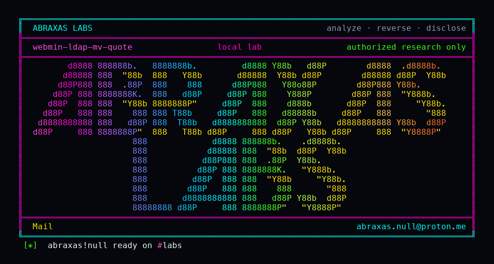

<p align="center">
  
</p>

# webmin-ldap-mv-quote

Webmin has two user editors. Unix Users already quotes the home path before it hands it to `mv`, and it forces the move off when the ACL says off. LDAP Users looks like the same form. It wraps both paths in single quotes, runs backticks, and never reads that ACL. I signed in as `ldapmod`, a Webmin user who is allowed to edit LDAP accounts and is not allowed to move home directories. A quote in the home field still ran as miniserv.

Someone with a normal LDAP Users login, the kind of account you give a directory clerk, can put a quote in a home path and run a command as the Webmin server. They do not need the "move home directory" permission. They do not need Unix Users. The local Users module already blocks the same payload. The LDAP copy of that save does not. The process is miniserv, which is usually root.

**Class:** Command injection
**Reach:** Remote (signed-in LDAP Users user, movehome denied)

**Webmin** `2.670` (`3a2b2b86`) - [webmin/webmin](https://github.com/webmin/webmin)

| | |
|---|---|
| ID | no CVE yet |
| Class | **Command injection** |
| Reach | **Remote** (signed-in LDAP Users user; `movehome` ACL 2 / off) |
| CWE | [CWE-78](https://cwe.mitre.org/data/definitions/78.html) |
| CVSS | **Critical: 9.1** `CVSS:3.1/AV:N/AC:L/PR:L/UI:N/S:U/C:H/I:H/A:N` |
| Product | [Webmin](https://github.com/webmin/webmin) |
| Affected | **2.670** tag `2.670` (`3a2b2b8671c0669c129f5275b3dd1853106ae02b`) `ldap-useradmin/save_user.cgi` |
| Auth | signed-in Webmin user with the LDAP Users module. `movehome` denied. Existing LDAP home present, new path absent. |
| License | [GNU Affero GPL v3.0](LICENSE) |
| Lab | loopback 127.0.0.1:18470-18474. Compose `webminh22`. OpenLDAP sidecar. Lab binds loopback only. |

## What an attacker can do

Needs a Webmin login that can open LDAP Users, plus an existing LDAP posixAccount whose home directory is already on disk. The ACL that is supposed to forbid moving that home is the leftover, not a skip.

| Privilege | Method / sink | Recon / integrity / availability | Lab-proven or inferred |
|---|---|---|---|
| Confirm LDAP Users ACL `movehome=2` (off) | `/etc/webmin/ldap-useradmin/ldapmod.acl` | Recon | Lab-proven. entrypoint writes 2 |
| Confirm Unix Users ACL `movehome=1` (can choose) | `/etc/webmin/useradmin/ldapmod.acl` | Recon | Lab-proven. sibling control |
| Open the LDAP user editor | `GET /ldap-useradmin/edit_user.cgi?dn=uid=labuser,ou=People,dc=lab,dc=invalid` | Recon | Lab-proven. HTTP 200, `labuser` in body |
| Run a command as miniserv via a quote in home | `POST /ldap-useradmin/save_user.cgi` `home=/home/labuser'; touch /tmp/WEBMIN-H22-LDAP-MV; echo '` `movehome=1` | Integrity (command as miniserv, usually root) | Lab-proven. witness file |
| Same quote against Unix Users | `POST /useradmin/save_user.cgi` same `home` | n/a | Lab-proven **closed**. `quotemeta`. witness-absent |
| Same class on LDAP batch modify | `ldap-useradmin/batch_exec.cgi` `mv "old" "new"` | Integrity (command as miniserv) | Inferred sibling. Lab ACL `batch=0`. Oracle is save_user |

**Stays closed on this leftover**

| Axis | Method / sink | Why it is closed |
|---|---|---|
| Integrity | `POST /useradmin/save_user.cgi` same quote | `quotemeta` on both paths. Witness absent |
| Integrity | Unauthenticated save | Session required. MiniServ 401 without `sid` |
| Integrity | Create-user path | `mv` only on modify when the old home exists and the new path does not |
| Integrity | Custom-command parameter injection | Public, fixed in 2.670. Not this CGI |
| Integrity | Squid cache-manager / shell autocomplete | Public. Different modules |
| Integrity | Module grant equals root | Out of policy. This leftover is an ACL the module already has and does not honor |

In plain language: the clerk is allowed to edit an LDAP user. They are not allowed to move that user's files. The LDAP save still runs `mv` as the server, and a quote in the path is a second command.

## How I found it

I pinned [webmin/webmin](https://github.com/webmin/webmin) tag [2.670](https://github.com/webmin/webmin/releases/tag/2.670) (`3a2b2b8671c0669c129f5275b3dd1853106ae02b`). The public custom-command injection is already closed on that peel. LDAP Users is a near-copy of Unix Users. Unix Users `save_user.cgi` line 477 forces `movehome` off when the ACL value is 2, and line 502 runs `quotemeta` on both paths. LDAP Users `save_user.cgi` line 474 is:

```perl
$out = `mv '$oldhome' '$home' 2>&1`;
```

`$home` comes from the request after a leading-slash check and an optional ACL prefix. A quote is a legal path character under that check. The field is a path, not a command.

Wrong turns, in the order they happened: treating this as "you gave them a module that can run commands" (Webmin's own policy says fine-grained ACLs are the control, and `movehome=2` is exactly that control); labbing `batch_exec.cgi` first (same quote class, double quotes, but the lab user has `batch=0`); treating create-user `makehome` as the sink (`mkdir` is a Perl builtin here; `mv` is the modify path); expecting the Unix Users POST to fire if I left `movehome=1` in the form (it does not; `quotemeta` holds even when the ACL lets you choose).

## Lab

```bash
python3 webmin-ldap-mv-quote-Abraxas-Labs.py
```

or:

```bash
cd lab
./run.sh
```

Clones [webmin/webmin](https://github.com/webmin/webmin) at `3a2b2b8671c0669c129f5275b3dd1853106ae02b` into `lab/src`. Loopback only. OpenLDAP sidecar on 127.0.0.1:18471. Webmin on 127.0.0.1:18470. Image `webmin-lab:2.670`. Compose `webminh22`.

`ldapmod` / `ldapmodpass`. LDAP Users ACL `movehome=2`. Unix Users ACL `movehome=1`. Same quote in `home` against both saves. Unix Users leaves `/tmp/WEBMIN-H22-LDAP-MV` absent. LDAP Users writes it.

```text
IOC useradmin-negative witness-absent
IOC ldap-save http=302 body=
IOC witness-path=/tmp/WEBMIN-H22-LDAP-MV
SUCCESS WEBMIN-H22-LDAP-MV ldap-useradmin-mv-quote WEBMIN-H22-LDAP-MV
```

## The fix

Do what Unix Users already does. Quote both paths with `quotemeta` (or `backquote_logged` plus `quotemeta`), and honor the ACL:

```perl
$in{'movehome'} = !$access{'movehome'} if ($access{'movehome'} != 1);
```

A `movehome` value of 2 means off. LDAP Users still shows the checkbox and still runs `mv` when the POST says yes. `batch_exec.cgi` needs the same quoting. A path is not a shell word.

## References

- [github.com/webmin/webmin](https://github.com/webmin/webmin) tag [2.670](https://github.com/webmin/webmin/releases/tag/2.670) (`3a2b2b8671c0669c129f5275b3dd1853106ae02b`)
- [`ldap-useradmin/save_user.cgi`](https://github.com/webmin/webmin/blob/3a2b2b8671c0669c129f5275b3dd1853106ae02b/ldap-useradmin/save_user.cgi) line 474 backticks `mv`
- [`useradmin/save_user.cgi`](https://github.com/webmin/webmin/blob/3a2b2b8671c0669c129f5275b3dd1853106ae02b/useradmin/save_user.cgi) line 477 ACL force-off, line 502 `quotemeta`
- [`ldap-useradmin/batch_exec.cgi`](https://github.com/webmin/webmin/blob/3a2b2b8671c0669c129f5275b3dd1853106ae02b/ldap-useradmin/batch_exec.cgi) line 469 double-quoted `mv`
- [CWE-78](https://cwe.mitre.org/data/definitions/78.html)

## License

GNU Affero GPL v3.0. See [LICENSE](LICENSE). Loopback lab only. No warranty.

Abraxas Labs
abraxas.null@proton.me
